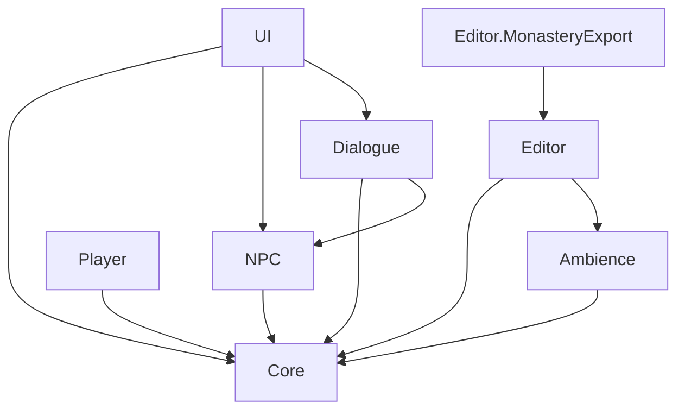

# Arquitectura

Visión general de cómo está organizado el proyecto: escena, módulos de código, flujo de una visita y configuración.
El detalle de cada parte está en [entorno.md](entorno.md), [personajes.md](personajes.md) y en los README de
`Assets/_Guadalupe/Scripts`.

## Escena

Todo ocurre en una sola escena, `Assets/_Guadalupe/Scenes/PlazaGuadalupe.unity`. El menú principal, el chat y los
avisos son paneles de UI Toolkit dibujados sobre la plaza, así que no hay cambios de escena ni pantallas de carga.

La jerarquía separa lo generado por herramientas de lo colocado a mano:

| Grupo | Contenido |
|---|---|
| `Entorno` | Terreno, casas, rótulos, faroles de pared y cortinas de luz. Lo crea el generador y se sustituye entero al regenerar. |
| `Monasterio` | Monasterio y atrio, como modelo con su prefab (`PF_Monastery`), con focos, reloj de la torre y adornos de Navidad. |
| `Mobiliario` | Fuente, terrazas, farolas, macetas, papeleras, bolardos, puestos, señales, monumentos y árbol de Navidad. |
| `Simulacion`, `Sol`, `Cielo`, `Postproceso` | Reloj de la simulación, aplicación del escenario, luz del sol, cúpula de nubes y volumen de postproceso. |
| `Iluminacion` | Controladores de faroles, focos del monasterio y luces de Navidad. |
| `Navegacion`, `LimiteJugable` | Superficie de la NavMesh y tapias invisibles que cierran la zona jugable. |
| `PuntosDeInteres`, `Turistas`, `PersonajesPrincipales` | Destinos de los turistas, generador de turistas y los cinco personajes con nombre. |
| `Sonido`, `Palomas` | Ambiente sonoro, campanas y bandada de palomas. |
| `Jugador`, `Conversacion`, `HUD`, `Chat`, `Interfaz` | Jugador y cámaras, director de la conversación e interfaz. |

## Módulos

Cada carpeta de `Assets/_Guadalupe/Scripts` es un ensamblado (`Guadalupe.<Módulo>`), con sus dependencias declaradas
en el asmdef. `Core` no depende de ningún otro y no hay dependencias circulares.

| Módulo | Responsabilidad | Clases principales |
|---|---|---|
| `Core` | Reloj y sol, sesión de la visita, escenarios, puntos de interés y límite jugable | `SimulationClock`, `SunController`, `SolarPosition`, `SessionState`, `ScenarioDefinition`, `PointOfInterest` |
| `Ambience` | Aplicación del escenario, cielo, faroles, focos, Navidad, sonido, palomas, sombrillas y reloj de la torre | `ScenarioApplier`, `SkyController`, `StreetLights`, `NightFloodLights`, `FestiveLights`, `AmbientAudio`, `PigeonFlock`, `TowerClock` |
| `Player` | Controles añadidos al jugador de Starter Assets: bloqueo en menú y conversación, cámara de la conversación, primera o tercera persona | `PlayerControlLock`, `ConversationCamera`, `PlayerViewModeSwitcher`, `KeyboardCameraControls` |
| `NPC` | Turistas y personajes principales | `TouristSpawner`, `Tourist`, `TouristCrowd`, `MainCharacter`, `Handshake`, `NpcProfile` |
| `Dialogue` | Conversación con Gemini en streaming, instrucciones de cada personaje y memoria de la visita | `ConversationDirector`, `Conversation`, `GeminiClient`, `PromptBuilder`, `VisitNote`, `LlmSettings` |
| `UI` | Menú principal, chat, aviso para hablar y subtítulos | `MainMenuController`, `ChatPanel`, `InteractionHud`, `MenuCameraShot` |
| `Editor` | Generador del entorno, horneado de la NavMesh, reglas de importación y materiales de personajes | `PlazaEnvironmentGenerator`, `NavigationBaker`, `*ImportRules` |
| `Editor.MonasteryExport` | Construcción y exportación a FBX del monasterio y del atrio | `MonasteryModelExporter`, `MonasteryBuilder` |

Criterios comunes:

- La lógica que no necesita la escena (reglas de saludo, posición del sol, multitudes, geometría, JSON de Gemini)
  está en clases C# normales, independientes de la escena; los `MonoBehaviour` hacen de adaptador.
- Los módulos se comunican con eventos (`SimulationClock.Changed`, `SunController.NightChanged`, cambios de la
  sesión) y con `SessionState`, un ScriptableObject compartido; no hay singletons.
- Los valores de diseño (distancias, colores, tiempos, intensidades) son campos serializados que se ajustan en el
  Inspector.

## Tiempo, luz y ambiente

`SimulationClock` avanza a tiempo real desde la hora de la franja elegida. A partir de él:

1. `SunController` calcula la posición real del sol en Guadalupe para la fecha del escenario (`SolarPosition`),
   orienta la luz direccional, ajusta su intensidad y color, y atenúa de noche la luz ambiental y los reflejos del
   cielo. Avisa con `Changed` y, al anochecer o amanecer, con `NightChanged`.
2. Con esos eventos se actualizan el cielo (`SkyController`), los faroles, focos y luces de Navidad (`StreetLights`,
   `NightFloodLights`, `FestiveLights`), las sombrillas (`TerraceUmbrellas`), el sonido (`AmbientAudio`) y las
   palomas (`PigeonFlock`). El cielo y las luces solo se recalculan cuando cambia la elevación del sol, no en cada
   frame. Cómo se ve cada uno está en
   [entorno.md](entorno.md#iluminación-y-ambiente).
3. `TowerClock` mueve las agujas del reloj de la torre con la hora de la simulación.

## Flujo de una visita

1. `MainMenuController` guarda el escenario y la franja en `SessionState`. `ScenarioApplier` fija la fecha y la hora
   del reloj, activa o no la Navidad y los focos, y `TouristSpawner` ajusta la gente según el escenario y la hora.
2. Durante la visita, Esc vuelve al menú y permite cambiar escenario y franja sin salir de la plaza.
3. Al acercarse a un personaje principal, `MainCharacter` se para, mira al jugador y saluda con una frase del
   momento (`GreetingRules`); `InteractionHud` muestra el bocadillo y el aviso para hablar.
4. Con F empieza la conversación: `ConversationDirector` bloquea el control del jugador, `ConversationCamera`
   encuadra la escena y el personaje abre con una de sus frases. Cada mensaje del jugador se envía a Gemini con las
   instrucciones de `PromptBuilder` (perfil, reglas comunes, hora, escenario, gente y notas de la visita) y la
   respuesta aparece en `ChatPanel` a medida que llega.
5. Al despedirse (Esc), la conversación se resume en una `VisitNote` con el nombre del jugador y lo que ha contado,
   que comparten los demás personajes durante el resto de la visita.

## Configuración

La conversación necesita una clave de la API de Gemini en un fichero `config.local.json`, copiado de la plantilla
`Assets/StreamingAssets/config.example.json` en `UserSettings/` (Editor) o en
la carpeta de datos de la aplicación (en macOS, `~/Library/Application Support/César Sánchez Montes/Plaza de Guadalupe/`;
en Windows, `AppData\LocalLow\César Sánchez Montes\Plaza de Guadalupe\`; en Linux,
`~/.config/unity3d/César Sánchez Montes/Plaza de Guadalupe/`); los pasos están en la [guía rápida](instalacion.md). El fichero no se sube al repositorio ni va dentro del ejecutable, y la
clave viaja en una cabecera sin escribirse nunca en el registro. Sin clave o sin conexión el resto del juego
funciona, y el personaje se disculpa y el chat indica dónde poner el fichero.
